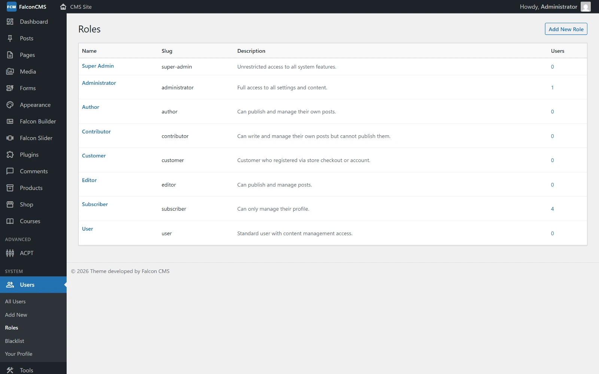

# Roles & Permissions

Falcon CMS includes a full Role-Based Access Control (RBAC) system. Every user has a role, and every role has a set of permissions.

## Built-in Roles

Installing FalconCMS seeds eight roles.

| Role | Slug | Description |
|---|---|---|
| **Super Admin** | `super-admin` | Bypasses all permission checks. Full access to everything. |
| **Administrator** | `administrator` | Full access to all settings, content, and configurations. |
| **Editor** | `editor` | Can publish and manage posts and media, and review the work of others. Can moderate comments. Pages are added on its role. |
| **Author** | `author` | For writers. Its permissions decide what it can do, the same as any role (see [Content Ownership](#content-ownership)). |
| **Contributor** | `contributor` | For occasional writers. Sends work for review rather than publishing it (see [Publishing and Review](#publishing-and-review)). |
| **Subscriber** | `subscriber` | Access to their own profile and basic dashboard view. |
| **User** | `user` | Standard user with content management access. |
| **Customer** | `customer` | Registered through store checkout or the account page. |

::: warning Customers never reach the dashboard
A user with the `customer` role is redirected to the shop account page on any admin URL —
this is enforced in middleware, not by permissions, so granting a customer extra
permissions will not let them in. Give a shop user who also needs the dashboard a
different role.
:::

## Managing Roles

Go to **Admin → Roles** to:
- Create custom roles
- Assign permissions to roles
- Edit or delete existing roles



*The built-in roles, with how many users hold each. Open one to see and edit its permissions, or add your own role.*

### Reading and changing are separate

A section with a list and an **Add New** beside it — Posts, Pages, every post type, Products,
Media, Users, Forms, and any plugin menu built the same way — has two permissions *(since
v2.8.5)*:

- the **list** lets a role **see** the items;
- **Add New** lets it **create, edit and delete** them.

A role with the list alone sees every row but no Add New button, no checkboxes and no Edit or
Delete links, and a change sent another way is refused. Every submenu has its own permission, so
ticking one screen of a plugin no longer ticks all of them; roles saved before keep the access
they had. Menus of plugins that are switched off are left out of the screen and keep their
grants for when the plugin comes back.

Two rules are enforced on this screen:

- **Administrator**, **Super Admin** and **Subscriber** cannot be deleted — they are system roles.
- The **Super Admin** role can only be opened and edited by a user who is themselves a Super Admin.

## Permissions Reference

| Permission | Controls |
|---|---|
| `access_dashboard` | View admin dashboard |
| `manage_posts` | Create, edit, delete all posts |
| `manage_pages` | Create, edit, delete all pages |
| `manage_media` | Upload and manage files |
| `manage_products` | Manage e-commerce products |
| `manage_users` | Create, edit, delete users |
| `manage_roles` | Manage roles and permissions |
| `manage_settings` | Access settings pages |
| `access_comments` | Moderate comments |
| `access_themes` | Switch and manage themes |
| `access_menus` | Manage navigation menus |
| `access_widgets` | Manage widget areas |
| `access_customizer` | Access theme customizer |
| `access_shop` | View shop overview |
| `access_orders_shop` | Manage orders |
| `access_languages` | Manage languages |
| `access_redirects` | Manage 301 redirects |
| `access_backup_restore` | Create and restore backups |

## Checking Permissions in Code

The `HasCmsPermissions` trait is automatically added to your `User` model during installation.

```php
$user = auth()->user();

// Check role
if ($user->hasRole('editor')) {
    // Editor-specific logic
}

// Check multiple roles (returns true if user has any)
if ($user->hasRole(['editor', 'author'])) {
    // ...
}

// Check a specific permission
if ($user->hasPermission('manage_posts')) {
    // ...
}

// Check if user has any of the given permissions
if ($user->hasAnyPermission(['manage_posts', 'manage_pages'])) {
    // ...
}

// Check if user has ALL permissions
if ($user->hasAllPermissions(['manage_posts', 'manage_media'])) {
    // ...
}
```

## Checking in Blade Templates

```blade
@if(auth()->user()->hasRole('administrator'))
    <a href="/admin/settings">Settings</a>
@endif

@if(auth()->user()->hasPermission('manage_posts'))
    <button>New Post</button>
@endif
```

## Assigning Permissions Programmatically

```php
$user = User::find(1);

// Give a permission directly to a user (not via role)
$user->givePermission('manage_posts');

// Revoke a permission
$user->revokePermission('manage_posts');
```

## Content Ownership

Access follows the role's permissions, not its name: since v2.8.5 every role — Authors and
Contributors included — sees every row of a list it may read, and with that section's **Add New**
permission can edit any item in it. To keep someone to reading, give their role the list without
Add New.

::: warning Access is per section
Access cannot be limited to a user's own posts or to one category.
:::

## Publishing and Review

**Publish without review** (under *Publishing* on the Roles screen) separates writing from going
live, for posts, pages, products and every custom post type. Ticked, a role publishes directly and
approves the work of others. Not ticked, everything it writes or edits goes live only after someone
approves it. Contributor, Subscriber and Customer do not have it by default; every other role does. A
new role has it only if you tick it.

A role that can write a section but cannot publish:

- saves drafts, and sends work with **Submit for Review**, which sets it to **Pending Review**;
- can edit what is live, and its edits go live after review. Readers keep seeing the current version
  until then. Its title, content, excerpt, images, SEO, categories, tags and terms go to review;
  address, publish date, price and stock, and custom fields are locked for it;
- cannot trash or restore what is published or scheduled, though it can clone it;
- is held to this everywhere: a publish sent through a bulk action, the API or a plugin becomes
  Pending Review.

A role that can publish sees a **Review** count in the admin bar, which opens the queue of everything
waiting. There, or at the top of the editor, it chooses **Approve & Publish** or **Request Changes**,
with an optional note. A request for changes returns the item to its writer as a draft, with the note
at the top of the editor. Reviewers and writers are emailed at each step, unless the
`editorial_notify` option is `0`. Approving publishes what was last saved, and a future publish date
schedules the item instead.

For an edit to live content, **Review Changes** shows each changed field, live and proposed, with a
preview. Only the changed fields are applied, so another edit made in the meantime is kept, and the
version it replaces goes into the item's revisions. **Request Changes** returns the edits to their
writer without touching the live version.

## Edit Locks

One person edits an item at a time, in the classic editor and the builder alike. Anyone else who
opens it sees who is editing, and can go back or **Take over**. Taking over stops the first person's
saves, and they are told, with the chance to copy their work or take it back. A list shows who has an
item open, and bulk actions skip it. A lock ends when the editor is left, or 150 seconds after a
browser stops renewing it, as after a crash.

The page builder follows the same rule *(since v2.8.18)*: a role with **Add New** for Pages (or
Posts, or a post type) can open those items in the builder and save them; one without it cannot.

## Sign-in Lockout

Every login form — the dashboard's, the shop's **My Account** and plugins' own (the wholesale
login) — shares one lockout *(since v2.8.5)*:

- **five wrong passwords** lock the account for **30 minutes**, counted across all the forms, so
  switching forms buys no extra guesses;
- an address that tried five **unknown** emails at the dashboard login is blocked, on every form;
- a storefront form makes an address that fails too often wait, and takes at most 10 tries a
  minute;
- the shop and wholesale forms say "Invalid email or password" whether or not the email has an
  account.

Locked accounts and blocked addresses are listed — with **Unblock** — under **Security →
Firewall** when Falcon Security is active, and you can add a bot check to each form under
**Settings → Integrations → Cloudflare Turnstile**.

## IP Blacklist

Administrators can block specific IP addresses from logging in:
- **Admin → Users → Blacklist** — View and remove blocked IPs
- Blocked users see an error on login attempt

## API Token Authentication

For REST API access:
1. Go to **Admin → Settings → API**
2. Click **Generate Token**
3. Use the token as a `Bearer` header:

```http
GET /api/v1/posts
Authorization: Bearer your-api-token-here
```
